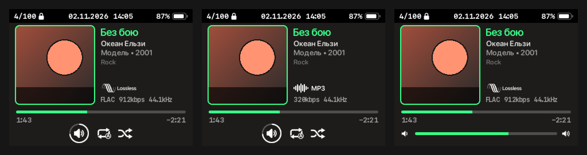
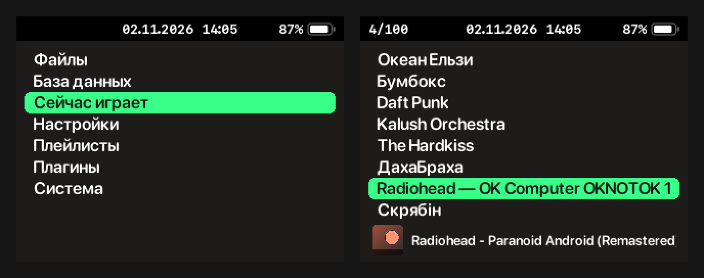
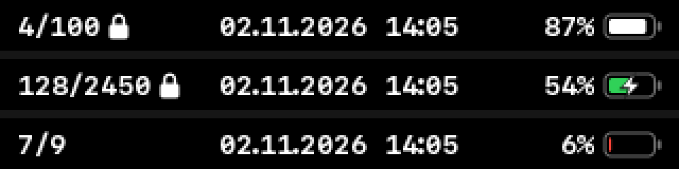

# Noir — a Rockbox theme for iPod Video / Classic

A dark, minimal theme for [Rockbox](https://www.rockbox.org) on **320×240** screens
(iPod Video 5G/5.5G, iPod Classic): warm near-black background `#1E1C1A`, neon-green accent `#39FF88`
and a macOS-style status bar. Built after *iPod reFresh Three*. Tested on **Rockbox 4.0**.




> Previews are rendered by a script from the theme's real fonts and bitmaps; the cover art and tags are samples.

## Features

**Status bar** (everywhere; black, SF Mono Bold)
- left: playlist position `4/100`, with a lock icon while Hold is on;
- centre: date and time `DD.MM.YYYY HH:mm`;
- right: battery percentage and a macOS-style battery (red when low, green with a bolt while charging).



**Playback screen**
- 136×136 album art with `rounded-md` corners and a 2px accent border;
- to the right: title (scrolls when too long), artist, `album • year`, genre;
- format badge: *Lossless* for FLAC / ALAC / WAV / AIFF / Shorten, otherwise a sound wave and the codec name;
- monospace file info line: `FLAC 912kbps 44.1kHz`;
- progress bar with rounded ends, elapsed and remaining time;
- volume, repeat and shuffle icons (white when on, dimmed when off). While the volume changes they are
  replaced by a volume slider, then fade back in.

**Menus**
- like reFresh but without icons, in SF Pro Rounded Semibold;
- the selected item is a green pill with rounded corners and padding;
- while music plays, a now-playing bar with a small cover and scrolling "artist - title" sits at the bottom.

## Installation

1. Build the theme (see [Building](#building)); `tools/package.sh` produces `dist/Noir.zip`.
   No prebuilt zip is published because it would contain Apple fonts.
2. Extract the zip **into the root of the player**, merging folders (it contains a `.rockbox` folder).
3. On the player: **Settings → Theme Settings → Browse Theme Files → Noir**.
4. The clock comes from the player: set it in **System → Time & Date**.

Tips:
- graphical equalizer: **Settings → Sound Settings → Equalizer → Graphical EQ**;
- hide main menu items with the plugin **Plugins → Applications → Main Menu Config**.

## Building

Requires **macOS** (fonts are converted from the system SF Mono and SF Pro Rounded), `python3`,
and FreeType for Rockbox's font converter:

```sh
brew install freetype pkgconf

./tools/make_fonts.sh              # fonts -> .rockbox/fonts (not in git, see License)
python3 tools/make_statusbar.py    # battery and lock
python3 tools/make_wps_assets.py   # progress bar, art border, icons, volume slider, fade frames
python3 tools/make_preview.py      # docs/*.png
./tools/checkwps.sh v4.0-final     # validate .wps/.sbs with Rockbox's own parser
./tools/package.sh                 # dist/Noir.zip
```

Bitmaps and previews are generated with plain Python, no dependencies. `checkwps.sh` downloads the
Rockbox sources for the given version once and builds `checkwps` for the iPod Video — the same skin
parser the player uses. Run it after every change to `.wps` / `.sbs`.

### Layout

```
.rockbox/
  themes/Noir.cfg         theme settings (colours, menu font, paths)
  wps/Noir.wps            playback screen
  wps/Noir.sbs            status bar and menus (skinned list)
  wps/Noir/*.bmp          bitmaps (generated)
  fonts/*.fnt             fonts (generated, not in git)
tools/
  statusbar.inc           status bar shared by .wps and .sbs
  statusbar_labels.inc    its hidden viewports (must stay at the end of both files)
  assets/refresh/         white icons extracted from reFresh
  make_*.py, *.sh         generators, validation and packaging
docs/                     README previews
```

### Changing colours

- background: `background color` in `Noir.cfg`, `BG` in `tools/make_wps_assets.py`, `%Vb(...)` in `Noir.sbs`;
- accent: `ACCENT` in `tools/make_wps_assets.py`, `%Vf(39FF88)` (track title) in `Noir.wps`,
  `%Vg(39FF88,...)` (selection) in `Noir.sbs`.

Then regenerate the bitmaps (`make_wps_assets.py`) and run `checkwps.sh`.

## License

Noir is based on **iPod reFresh Three** by Ciprian Dragu (CC BY-SA 3.0) and uses icons derived from it,
so Noir is released under **[CC BY-SA 3.0](LICENSE)**.

Fonts are not part of the repository: they are converted from Apple's SF Mono / SF Pro Rounded,
whose licence only allows use on Apple platforms. Build them locally with `tools/make_fonts.sh`.
